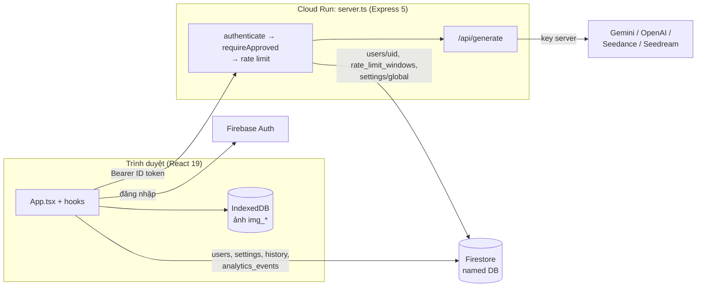
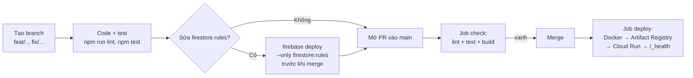

# 00 - Onboarding cho người mới

Lộ trình từ lúc clone repo đến khi merge PR đầu tiên. Đọc theo thứ tự; mỗi bước có cách tự kiểm tra là đã xong.

Cập nhật: 29/10/2026.

---

## 1. Dự án trong 1 phút

AI Image ZVAS là web app nội bộ tạo và biến thể ảnh bằng AI. User đăng nhập bằng username/mật khẩu do admin cấp, nhập prompt (kèm ảnh gốc / ảnh tham chiếu nếu muốn), chọn model, nhận về nhiều ảnh. Admin quản lý user, bật/tắt provider, xem dashboard chi phí và lỗi.

- **Một process Node** (Express 5) vừa phục vụ frontend React (build bằng Vite) vừa cung cấp `/api/*`.
- **Firebase**: Auth (email/mật khẩu) + Firestore (named database) cho user, cấu hình, lịch sử, analytics.
- **Key AI chỉ ở server** (env / Secret Manager). Trình duyệt không bao giờ giữ key.
- **Ảnh kết quả lưu ở IndexedDB trình duyệt**, Firestore chỉ giữ metadata.
- **Chạy trên Cloud Run**, deploy tự động khi merge PR vào `main`.



---

## 2. Lộ trình đọc

| Bước | Đọc | Mục tiêu | Tự kiểm tra |
| ---- | --- | -------- | ----------- |
| 1 | `README.md` (gốc), doc này §3 | Chạy được app ở máy | `curl localhost:3000/_health` → `{"status":"ok"}` |
| 2 | [01 - Tổng quan](./01-overview.md), [08 - Đăng nhập](./08-auth-users-setup.md) | Hiểu user/role/trạng thái duyệt | Đăng nhập được, tạo được 1 ảnh |
| 3 | [04 - Workflow](./04-workflow-analytics.md), §5 doc này | Lần theo 1 request tạo ảnh từ nút bấm tới provider | Kể lại được 7 bước, chỉ đúng file |
| 4 | [02 - Frontend](./02-frontend-architecture.md), [03 - Backend & API](./03-backend-api.md) | Biết code nằm đâu | Trả lời được bảng §7 mà không cần tra |
| 5 | [05 - Security & roles](./05-security-roles.md) | Biết các lớp chặn và vì sao | Giải thích được vì sao base URL provider phải qua allowlist |
| 6 | [06 - Deploy](./06-live-deployment.md) §0, [RELEASE_CHECKLIST](./RELEASE_CHECKLIST.md) | Hiểu đường từ PR ra production | Mở 1 PR nhỏ, job `check` xanh |
| 7 | Doc 07, 09–16 (nhật ký thay đổi) | Biết lịch sử, lý do của các quyết định | Đọc lướt, tra khi gặp code lạ |

Doc 07, 09–16 là **nhật ký theo thời điểm** — có thể chứa chi tiết đã lỗi thời. Khi mâu thuẫn, tin docs 01–06, 08 và code.

---

## 3. Cài đặt môi trường local

### 3.1 Cần xin trước (từ owner dự án)

| Thứ cần | Dùng để | Ghi chú |
| ------- | ------- | ------- |
| Quyền vào Firebase project `zvas-ai-image` | Xem Firestore/Auth, deploy rules | Console: Firestore → chọn đúng **named database** |
| Nội dung `firebase-applet-config.json` | Frontend + server biết project/database | Không có trong Git |
| `service-account.json` (hoặc đường dẫn qua `GOOGLE_APPLICATION_CREDENTIALS`) | Server verify token, đọc Firestore, tạo user | Không commit; tên file đúng, không khoảng trắng đầu |
| `GEMINI_API_KEY` (dev) | Gọi Gemini | Key của provider khác chỉ cần nếu test provider đó |
| Tài khoản app (username + mật khẩu) | Đăng nhập | Hoặc tự tạo theo §3.3 |
| Quyền GitHub repo `thanhnghiep1208/zVas-AI-Image` | Mở PR | `main` chỉ nhận merge qua PR |

### 3.2 Các bước

Yêu cầu: Node.js 22 (trùng CI và Docker image).

1. `npm install`
2. Sao chép `firebase-applet-config.example.json` → `firebase-applet-config.json`, điền giá trị thật.
3. Đặt `service-account.json` ở thư mục gốc.
4. Sao chép `.env.example` → `.env.local`, bỏ comment và điền `GEMINI_API_KEY`. Các biến khác đều tuỳ chọn khi dev.
5. `npm run dev` → mở `http://localhost:3000`.

Kiểm tra nhanh trước khi viết code:

```bash
npm run lint
```

```bash
npm test
```

Cả hai phải sạch.

### 3.3 Tạo tài khoản để đăng nhập

- Đã có admin: admin vào **Admin → Users** tạo user (mật khẩu ≥ 12 ký tự).
- Có user trên Firebase Auth nhưng thiếu hồ sơ Firestore (màn "Tài khoản chưa được cấu hình"):

```bash
npm run provision-user -- --uid <FIREBASE_AUTH_UID> --username <ten> --role admin --status approved
```

Document `users/{uid}` phải dùng **UID** làm ID, không phải username. Chi tiết: [08](./08-auth-users-setup.md).

### 3.4 Lỗi hay gặp khi setup

| Triệu chứng | Nguyên nhân |
| ----------- | ----------- |
| `npm run dev` crash ngay, không tìm thấy `firebase-applet-config.json` | Chưa làm bước 2 |
| Đăng nhập xong kẹt ở landing / màn "chưa được cấu hình" | Thiếu `users/{uid}` hoặc ID doc không phải UID |
| `/api/generate` trả `403 account_not_approved` | `status` chưa là `approved` |
| `/api/admin/users` trả `503` | Server không nạp được service account — restart sau khi thêm file |
| Nút Generate bị khoá, báo thiếu key | `GET /api/provider-keys` thấy key provider đang chọn chưa có trong env |
| Firestore `permission-denied` | Sai named database, hoặc rules trên server chưa deploy bản mới |

---

## 4. Bản đồ code

```
App.tsx, index.tsx        Entry frontend: Sentry, auth gate, chọn view
components/
  landing/, guards/       Trước khi vào tool: landing, login, pending/rejected/thiếu hồ sơ
  AppAuthenticatedShell   Shell sau đăng nhập, lazy các view
  views/                  CreateView, MergeImage, MultipleImage (3 chế độ)
  inputs/, prompts/,      Upload ảnh, quản lý prompt, hiển thị kết quả,
  results/, viewers/      thư viện phong cách, xem fullscreen
  layout/                 Header (chọn model, phiên đăng nhập), footer
  admin/, analytics/      Dashboard admin (Users, Settings, Analytics)
hooks/                    Toàn bộ logic: auth, settings, generate, history, polling...
services/                 geminiService (client gọi /api/generate), analytics I/O + aggregation
data/                     Repository Firestore phía client (history, analytics, sessions)
lib/                      Prompt pipeline, phân loại lỗi, style guide, Sentry
utils/                    Helper thuần (ảnh, nén, validate file, giá, GA4...)
constants/                Danh sách model, kích thước ảnh, prompt modifiers (dùng cả client + server)
server.ts                 Entry Express: helmet/CSP, CORS, /_health, Vite dev middleware
server/
  middleware/             authenticate, requireApproved, requireAdmin
  routes/                 generate, providerTest, providerKeys, adminUsers
  lib/                    rate limit, resolve provider/model, Gemini retry, SSRF, validate
  repositories/           Admin SDK: analytics rollup
firestore.rules           Quyền đọc/ghi Firestore (deploy tay)
.github/workflows/        CI (check) + deploy Cloud Run
docs/                     Tài liệu (so-sanh-model-gemini.md được app import trực tiếp)
```

Quy ước:

- Test đặt cạnh file nguồn, tên `*.test.ts` (runner `tsx --test` **không** chạy `.test.tsx`).
- Server import `utils/` và `constants/` — thêm thư mục top-level mới mà server import thì phải thêm `COPY` vào `Dockerfile` (có test `scripts/dockerfileCoverage.test.ts` canh).
- Comment, commit message, UI text viết tiếng Việt; commit theo dạng `feat(scope): ...`, `fix(scope): ...`.

---

## 5. Lần theo một lượt tạo ảnh

Bài tập tốt nhất cho ngày đầu: mở từng file theo thứ tự và đặt breakpoint/log.

| # | Nơi | Việc |
| - | --- | ---- |
| 1 | `components/views/CreateView.tsx` | User bấm Tạo |
| 2 | `hooks/useImageGeneration.ts` | Chặn click kép, ghi `image_generation_started`, gọi service |
| 3 | `lib/buildGenerationPrompts.ts` | Ghép prompt + phong cách + tuỳ chọn thành danh sách prompt |
| 4 | `services/geminiService.ts` → `generateImageVariations` | Nén ảnh, base64, gửi **1 request/prompt** tới `/api/generate` kèm ID token |
| 5 | `server/middleware/authenticate.ts`, `requireApproved.ts` | Verify token, kiểm tra user đã duyệt |
| 6 | `server/routes/generate.ts` | Rate limit → đọc `settings/global` → chọn provider (`resolveProvider`) → validate prompt |
| 7 | `server/lib/resolveGeminiModel.ts`, `geminiGenerate.ts` | Chọn model hợp lệ (có rollback), gọi Gemini với retry/timeout, phân loại lỗi |
| 8 | quay lại `useImageGeneration.ts` | Ghi `history` (`data/historyRepository.ts`), lưu ảnh vào IndexedDB `img_{id}`, ghi analytics success/failed |
| 9 | `components/results/ResultsDisplay.tsx` | Hiển thị ảnh, lỗi qua `GenerationErrorAlert` |

---

## 6. Dữ liệu

| Nơi lưu | Nội dung | Ai ghi |
| ------- | -------- | ------ |
| `users/{uid}` | Hồ sơ: `role` (`admin`/`advice`/`editor`), `status` (`approved`/`pending`/`rejected`) | Admin API / script provision |
| `users/{uid}/sessions/{id}` | Phiên đăng nhập đa thiết bị | Client (owner) |
| `settings/global` | Provider bật, model, base URL, `geminiFlashRollback` — **không có key** | Admin |
| `settings/public` | `loginContactText` trên popup đăng nhập (ai cũng đọc được) | Admin |
| `history/{id}` | Metadata ảnh đã tạo (theo `uid`) | Client |
| `analytics_events/{id}` | Sự kiện login / generate / download | Client |
| `analytics_monthly_rollups/{YYYY-MM}` | Số liệu tháng tổng hợp sẵn | Server (Admin SDK) |
| `monthly_costs/{YYYY-MM}` | Chi phí tháng | Admin |
| `rate_limit_windows/{id}` | Bộ đếm rate limit | Chỉ server |
| IndexedDB `img_{historyId}` | Ảnh thật | Trình duyệt |

Server dùng Admin SDK nên **bỏ qua** `firestore.rules`; client luôn bị rules giới hạn.

---

## 7. Muốn sửa X thì vào đâu

| Việc | File chính | Lưu ý thêm |
| ---- | ---------- | ---------- |
| Thêm/đổi model | `constants/aiModels.ts` (+ test) | Gemini: cập nhật `ALLOWED_GEMINI_MODEL_IDS`; popup so sánh `docs/so-sanh-model-gemini.md` |
| Thêm provider mới | `server/routes/generate.ts`, `providerTest.ts`, `server/lib/resolveProvider.ts`, `providerKeys.ts`, `constants/aiModels.ts` | Thêm host vào CSP `connect-src` nếu client gọi; base URL do client gửi phải qua allowlist |
| Thêm field vào `settings/global` | `hooks/useAdminSettings.ts`, `utils/adminSettingsPayload.ts`, `firestore.rules` (`isSafeGlobalSettings`) | Deploy rules **trước** merge, nếu không admin không lưu được |
| Thêm phong cách ảnh | `ai_styles.json` + `assets/images/styles/<id>.webp` | Test `lib/styleGuide.test.ts` báo thiếu thumbnail |
| Đổi prompt pipeline | `lib/buildGenerationPrompts.ts`, `constants/promptModifiers.ts` | Có test |
| Thêm route API | `server/routes/*`, đăng ký trong `server/routes/index.ts` | Luôn `authenticate` + `requireApproved`/`requireAdmin`; route gọi ra ngoài thì thêm rate limit |
| Thêm sự kiện analytics | `services/analyticsService.ts` (`trackEvent`), `utils/gtagEvent.ts` (GA4) | Rules `analytics_events` yêu cầu `user_id == auth.uid` |
| Đổi giao diện chung | `components/layout/`, `index.css` (`@theme`) | Font: `font-display` / `font-sans` / `font-mono` |
| Đổi rate limit | `server/lib/rateLimit/config.ts` | Áp chung cho generate + provider-test |

---

## 8. Quy trình làm việc



- Không push thẳng `main` (ruleset **Protect main**); mỗi commit lên `main` = một lần deploy production.
- Firestore rules/indexes **không** deploy tự động.
- Đổi secret/env Cloud Run làm tay (Mode B, doc 06 §3), không qua PR.
- Không deploy từ Google AI Studio (doc 06 §9.1).
- Rollback: chuyển traffic về revision cũ (doc 06 §6). Rollback model Nano Banana 2.1 → 2 làm trong Admin, không cần deploy.
- Sau khi merge: theo dõi tab Actions và log Cloud Run; checklist trong [RELEASE_CHECKLIST](./RELEASE_CHECKLIST.md).

---

## 9. Bẫy cần nhớ

1. **Key provider chỉ ở server.** Không thêm `VITE_*` chứa key; `VITE_*` bị nhúng vào bundle công khai.
2. **Client không đáng tin.** Mọi kiểm tra quyền phải có ở server (`requireApproved`, `requireAdmin`) hoặc rules, không chỉ ẩn nút.
3. **Base URL từ client = rủi ro rò key.** Mọi URL provider phải qua `validateProviderBaseUrl` + `ssrfSafeFetch`.
4. **Rules trước app** khi thêm field mà client ghi.
5. **Dockerfile COPY** đủ thư mục mà server import.
6. **Test phải là `.test.ts`.** File `.test.tsx` bị bỏ qua im lặng.
7. **`docs/so-sanh-model-gemini.md` là code**: app import nó qua `?raw`, đổi tên/xoá sẽ vỡ build.
8. **Gemini retry tốn tiền**: mỗi lần retry có thể bị tính phí; timeout không retry.
9. **GA4 chỉ gửi ở bản production build**; `npm run dev` không làm nhiễu số liệu.

---

## 10. Checklist tuần đầu

- [ ] Chạy được app local, đăng nhập, tạo 1 ảnh với Gemini.
- [ ] `npm run lint` và `npm test` sạch.
- [ ] Lần theo §5 và đặt log ở bước 4, 6, 8.
- [ ] Mở Firestore Console, tìm document `users/{uid}` và `history` của chính mình.
- [ ] Đọc `firestore.rules` một lượt, đối chiếu với bảng §6.
- [ ] Mở một PR nhỏ (vd. sửa docs), chờ job `check` xanh.
- [ ] Đọc doc 15 và 16 để hiểu hai sự cố gần nhất và cách đã xử lý.
